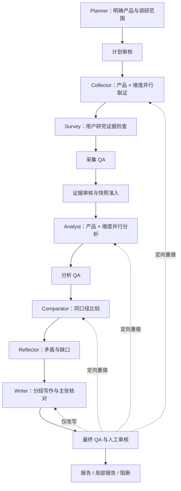

# Competiscope v2 · 产品调研与竞品分析工作台

输入一个目标产品，发现同类竞品与替代方案，采集可追溯资料，生成带引用的产品分析报告。适用于软件、硬件及其他产品品类。LLM 负责规划、提取、分析与写作，RAG 复用历史一手资料；用户要求、模型推断和来源事实分别记录。

前端为明亮的田园像素桌面，提供应用窗口、任务栏、任务管理、项目文件、知识库、证据、报告和设置。关闭窗口后，后台调研任务继续执行。

## 能做什么

- **产品经理视角调研**：目标用户、使用场景、共同能力、定价、竞争关系、切换成本及待验证的产品机会。具体覆盖范围取决于研究维度与合格证据。
- **三种研究深度**：极简、适中、详细分别控制竞品数、研究范围、搜索与模型预算、报告长度。
- **全 AI / 半人工**：半人工模式在计划、证据和最终审核节点等待用户决策，支持定向补证和分阶段重做。
- **联网取证**：官方站点、搜索、网页抓取、可选浏览器渲染及手工资料；拒绝登录壳、无关报价和不能支撑主张的摘要。
- **共享证据**：全文和分块入库、版本/哈希校验、工作区与项目范围隔离；各分析阶段读取同一已准入快照。
- **报告闭环**：按维度分段写作、逐条主张与引用核对、独立价格段、短局部报告、人工改稿、版本记录与 Markdown 下载。
- **执行可观察**：调用记录、阶段预算、证据消费依赖和回退状态可追踪；任务结束与报告达到交付标准分别判断。

## 实际 Agent 流水线



| Agent | 实际执行功能 | 资料使用方式 |
| --- | --- | --- |
| Planner | 目标产品研究、竞品发现、范围和任务拆解 | 搜索与目标资料；规划条件不充当事实 |
| Collector | RAG 预检索、联网采集、有界语义提取、按具体问题缺口补证 | 先重用已抓正文，再用剩余额度补抓；候选资料需准入 |
| Survey | 检查真实用户研究资料 | real 模式不会用模拟访谈填充事实 |
| Analyst | 按产品与维度生成结构化分析、条件和引用 | 当前快照的逐题证据包，记录实际发送与遗漏 |
| Comparator | 比较同一操作、对象及角色/套餐/访问前提 | 同身份逐题选择及有效 Analyst 产物；预算不足保留缺口 |
| Reflector | 检查矛盾、薄弱结论和待补资料 | 区分实际上下文省略与真正缺证，保留未知和矛盾 |
| Writer | 按维度写作、独立价格段、逐条窄支持审核与正式结论 | 原子绑定、完整条件；请求歧义生成固定澄清，其他问题仍保留缺口 |
| QA | 采集/分析/最终审核与重做路由 | 重放主张支持范围和完整回答记录，保留真实来源及预算阻断 |

详细入口、输入输出、Prompt、回退和重做规则见 [Agent 执行说明](docs/agent-execution.md)。

## 研究模式

| 设置 | 选项 | 作用 |
| --- | --- | --- |
| 竞争视角 | L1 直接竞品 / L2 相邻替代 / L3 市场视角 | 控制竞品发现范围 |
| 研究深度 | quick 极简 / standard 适中 / deep 详细 | 控制范围、预算与报告长度；部署上限仍生效 |
| 协作方式 | AI / assisted 半人工 | 决定是否在三个审核点等待用户 |
| 执行方式 | demo / real | demo 使用合成资料，real 使用实际配置的资料与服务 |

可填写目标产品官网、品类、市场、受众、场景和决策问题，也可手动指定竞品。报价需保留市场、方案、席位、计费周期、币种、税费和核验时间；缺少条件时不生成确定金额结论。

## 本机启动

要求 Python 3.11+、Node.js 与 pnpm。在仓库根目录安装依赖：

```bash
python3 -m venv .venv
.venv/bin/python -m pip install -e './backend[dev]'
pnpm --dir frontend install --frozen-lockfile
cp .env.example .env
```

### 无 Docker 的桌面演示

分别在两个终端执行：

```bash
# 终端 1：演示 API、内存企业存储、LangGraph
COMPETISCOPE_LOAD_ENV_FILES=0 DEMO_MODE=true ENTERPRISE_STORE_BACKEND=memory \
RUN_ORCHESTRATION_BACKEND=langgraph TEMPORAL_TRAFFIC_PERCENT=0 \
.venv/bin/python -m uvicorn app.main:app --app-dir backend --host 127.0.0.1 --port 8000

# 终端 2：前端
pnpm --dir frontend dev --host 127.0.0.1 --port 5173 --strictPort
```

打开 [本地桌面](http://127.0.0.1:5173)。演示 API 不启动 Postgres、Temporal 或 Qdrant，演示报告不用于证明真实调研准确率。各终端用 Ctrl+C 停止。

### 完整开发服务

需要 Docker，配置 `.env` 后执行：

```bash
bash scripts/dev_start.sh
bash scripts/dev_status.sh
bash scripts/dev_stop.sh
```

Windows 使用 `scripts/dev_start.ps1`、`dev_status.ps1` 和 `dev_stop.ps1`。脚本管理 Postgres、Temporal、Temporal UI、Qdrant、API、worker 和前端，并记录本次进程。发现端口被占用时应核对进程；macOS/Linux 可传 `--backend-port`、`--frontend-port`，Windows 可传 `-BackendPort`、`-FrontendPort`。

默认端口：API `8000`、前端 `5173`、Temporal UI `8233`、Temporal gRPC `7233`、Qdrant HTTP `6333`。

在负责部署的电脑上，使用 Python 3.11+ 和 Docker Compose v2：

```bash
# 预览不执行 Docker，也不读取实际 .env
python scripts/docker_deploy.py --mode light --redis --dry-run
# 配好该电脑的 .env 后执行：轻量持久化演示
python scripts/docker_deploy.py --mode light --redis --build
# 需要 Temporal 时，使用独立项目并错开端口
python scripts/docker_deploy.py --mode persistent --project plan-a-persistent --redis --build
```

默认入口为 `http://127.0.0.1:8080`；内网访问需显式 `--lan` 且配置 API 鉴权。
可选 Redis 已接入公共网页缓存和共享限流；缓存保留原采集时间，失败按 miss 处理，限流服务不可用返回 503。
LangGraph 运行支持持久检查点显式恢复，SSE 支持事件游标续传。恢复接口、数据卷、备份及隔离故障验收见
[部署说明](docs/docker_deployment.md)和[本轮交付记录](docs/optimization/2026-10-16-demo-deployment-delivery.md)。
本轮本机未运行 Docker；真实容器、Redis Lua/TTL、Postgres、Qdrant HTTP 与 Temporal 的跨机验收仍待执行。
部署改造的离线完整回归为 **4477 通过、1 跳过**，前端接口生成与生产构建通过；这不代表真实调研报告的内容验收通过。

## 实际模型与搜索配置

把密钥保存在本机 `.env` 或部署密钥服务中。下面均为占位符；`ARK_*` 是现有 OpenAI 兼容主模型适配器的配置名。

```dotenv
DEMO_MODE=false
ARK_BASE_URL=https://api.deepseek.com
ARK_API_KEY=replace_with_your_key
ARK_MODEL=deepseek-flash
LLM_PROVIDER_NAME=deepseek
WEB_SEARCH_PROVIDER=deepseek
DEEPSEEK_WEB_API_ENABLED=true  # 可选复验模式，默认关闭
```

独立 Search／Fetch 可复用官方 DeepSeek 主模型凭据，也可单独设置 `DEEPSEEK_API_KEY`；工具请求和计费请求估计单列，不计作生成 token。`DEEPSEEK_WEB_API_ENABLED` 默认关闭，上例显式开启，修改配置后需重启后端；关闭时保留旧原生搜索与浏览器链，原生模型由 `DEEPSEEK_SEARCH_MODEL` 选择。使用 Perplexity 时改为 `WEB_SEARCH_PROVIDER=perplexity` 并设置 `PPLX_API_KEY`。自动发现竞品需要可用搜索服务，Search 摘要仍需抓取和核验；Fetch 的 API 成功也不保证取得合格原文。动态页面可选安装 `js-render` 依赖与 Chromium，扫描 PDF 需先 OCR。

用 `RUN_LLM_MAX_TOKENS`、调用次数和费用预算限制单次运行；工作区月度额度独立生效。预算不足会明确阻断或回退，不能保证所有阶段都完成模型调用。部署前还需配置 API 授权与持久化存储，默认演示配置不适合直接对外开放。

## RAG 与知识复用

RAG 用于复用可追溯的一手资料、统一各 Agent 的证据，并限制资料作用域与版本。旧报告可用于查找线索，不能代替原始资料直接证明新主张。

```text
抓取 / 导入 → 清洗、去重与分块 → SQLite 原文及 FTS5 + Qdrant 向量索引
问题 / 研究维度 → 原句＋结构化查询 → 稀疏与稠密召回 → 双路 RRF → 可选原句精排
→ 原文、版本、范围、时效与来源角色校验 → 同文档有界上下文补全
→ Collector 提取与准入 → 共享证据快照
→ Analyst / Comparator / Reflector / Writer / QA
```

- 稀疏检索使用 SQLite FTS5/BM25；Qdrant 提供向量检索。混合召回在共享检索服务中融合。
- 生产检索保留原问句一路；结构化子查询先内部融合，再与原句一路等权 RRF。精排使用完整原句，重复查询只执行一次。两路采用相同的范围、时效与索引校验。
- 排名锚块保持不变，另附当前文档的短章节/短全文或相邻块，附带原文坐标和哈希。每条上下文最多 3000 字符，每次最多额外 6000 字符；无法校验、重复区间或超预算时记录跳过原因。补全不自动证明条件属于某项能力，仍需提取和准入。
- 默认 hash embedding/reranker 用于确定性开发测试，不具备真实多语语义能力。
- 已接入本机 `intfloat/multilingual-e5-small` 与可选 `BAAI/bge-reranker-v2-m3`。配置、固定 revision 和本地路径参考 [本机模型配置示例](docs/optimization/2026-10-14-local-rag-profile.env.example)，复制后需修改为自己的权重路径。
- 用 `GET /api/knowledge/providers` 检查实际 provider、模型和降级状态；更换 embedding 后需重建对应模型版本的索引。严格验收应设置 `KB_LOCAL_MODEL_STRICT=1`，避免加载失败退回 hash 而误报语义检索可用。
- 本机持久化可设置 `KB_QDRANT_LOCAL_PATH`；多人/多进程部署使用 Qdrant HTTP 服务，并让 API 与 worker 使用一致配置。本机持久化模式的验证不能替代 HTTP 集群验收。
- 检索受工作区、项目、来源角色及资料时效限制。正文与审核消费准入快照，修改或退休来源会使相关下游依赖失效。

本机语义模型还需安装 `sentence-transformers` 等可选依赖：

```bash
.venv/bin/python -m pip install -e './backend[bge-m3]'
```

离线比较使用固定资料、本机权重和网络拦截：

```bash
# 不加载模型：列出固定输入及哈希
PYTHONPATH=backend .venv/bin/python backend/scripts/eval_independent_retrieval.py \
  --local-profile /absolute/path/to/local-rag.env --output /tmp/retrieval-result.json

# 已准备本机权重后，执行比较
PYTHONPATH=backend .venv/bin/python backend/scripts/eval_independent_retrieval.py \
  --local-profile /absolute/path/to/local-rag.env --output /tmp/retrieval-result.json --run

# 新候选集仅作诊断；未人审时不能用默认 formal 模式
PYTHONPATH=backend .venv/bin/python backend/scripts/eval_independent_retrieval.py \
  --local-profile /absolute/path/to/local-rag.env \
  --dataset-prefix eval/product-research-holdout-v2 --mode candidate-diagnostic \
  --product-scope broad --output /tmp/candidate-retrieval.json --run

# 十二组消融：原句、仅结构化、双路、双路加补全，各测三种检索配置
PYTHONPATH=backend .venv/bin/python backend/scripts/eval_independent_retrieval.py \
  --local-profile /absolute/path/to/local-rag.env \
  --output /tmp/dual-context-result.json --ablation --run
```

`--product-scope product` 可另测显式产品范围。两种范围应分别报告，不能把已知产品过滤的结果冒充全库表现。脚本在加载模型前校验审核状态与原文坐标，执行前后校验输入和实际导入检索代码的哈希；本机模型初始化失败会中止评测。不加 `--ablation` 时保留旧六组对照，关闭双路和补全；该评测默认与生产检索默认不同。消融分别统计来源召回、锚块引文和补全后引文，额外文本的覆盖收益不能冒称排序收益。

## 验证与交付边界

本轮[完整引用支持与回答投影](docs/optimization/2026-10-20-bound-answer-projection.md)：v3 按单条主张隔离窄引用支持及最终重放，修复 Bitwarden 上限结论、增加不夹带产品事实的固定离职澄清。最终后端 **6452通过／1跳过**，较基线新增144项；变更范围Ruff、API／旧TS、构建和独立累计审查通过。四组各首次 **38调用／129433 token**；正文与保存记录均 **5正确／0错误／3遗漏**，发表主张 **5/7完整绑定**。局部内容 **2/4**，内容与绑定同时 **0/4**，系统仍 **0/4交付、6阻断**。BW额外共享动作超出窄span、1Password将“可以”强化为“必须”、CF有规则仍漏答、Dropbox抓取失败及真实核心上下文遗漏尚未解决。730冻结文件、5个helper、1332旧文件及9份捕获可核验；当前仍degraded_lexical。已曝光非盲、非受控A/B，非全Graph／生产稠密RAG验收；新报告未获用户验收，未训练。[结构化结果](docs/optimization/2026-10-20-bound-answer-projection-results.json)。

上一轮[逐题证据包与原子回答复验](docs/optimization/2026-10-20-agent-question-packets.md)：统一 Analyst／Comparator／Reflector／Writer 逐题入口，新增 v3 原子计划、独立澄清、确定性 reason 及最终收据／实际直接依赖回放。后端 **6308通过／1跳过**，变更范围Ruff、API兼容、构建和累计审查通过。四组各首次 **30调用／123676 token**；正文与保存记录均 **3正确／0错误／5遗漏**，发表观察 **5/6完整绑定**。局部内容 **1/4**，内容与绑定同时 **0/4**，系统 **0/4交付、8阻断**；BW离职澄清与上限结论遗漏、1Password复合句半绑、CF范围误判、Dropbox正文抓取及Writer派送遥测不一致仍待修。725冻结文件、五个helper与1181旧文件未改，9份捕获可核验。已曝光非盲、非受控A/B，未证明质量或token效率改善，未获用户验收、未训练。[结构化结果](docs/optimization/2026-10-20-agent-question-packets-results.json)。

上一轮[逐题证据交付修复与四产品复验](docs/optimization/2026-10-20-question-delivery-repair.md)：最终后端 **6151通过／1跳过**，新增169项测试；变更范围Ruff、API兼容、前端构建与累计审查通过。四组各首次 **30调用／116410 token**；正文 **5正确／0错误／3遗漏**，保存记录 **4正确／1错误／3遗漏**。Cloudflare两题与全部发表引用满足局部内容标准，但**系统仍0/4交付**；Bitwarden离职题遗漏、Dropbox抓取404、两条额外主张绑定不全及Reflector局部选证/误判仍待修。721份冻结文件、helper及1090旧文件未改；9份捕获哈希可核验。已曝光非盲，非受控A/B，新报告未获用户验收，未训练。[结构化结果](docs/optimization/2026-10-20-question-delivery-repair-results.json)。

上一轮[DeepSeek Search／Fetch 与证据消费](docs/optimization/2026-10-19-deepseek-web-delivery.md)：接入可选独立网页工具、通用章节身份、Writer 原句与条件绑定，补取消计量和调用前完整冻结校验。最终后端 **5982通过／1跳过**，新增171项测试，变更范围Ruff、OpenAPI及累计审查通过。四组各首次运行 **22调用／75844 token**；正文 **2正确／1错误／5遗漏**，最终记录 **2正确／6遗漏**。独立审读仅认可Cloudflare两题内容，**系统交付仍0/4**；Bitwarden有遗漏与条件泛化，1Password已抓正文但准入失败，Dropbox工具404，Cloudflare仍有门禁误阻待核对。713份冻结文件在运行期间不变，生产源码及312旧产物不变，9份捕获可核验；提交前仅清理一处测试EOF空行，AST一致。已曝光非盲，未获用户验收，未训练；新路线默认关闭，本机配置未改。[结构化结果](docs/optimization/2026-10-19-deepseek-web-delivery-results.json)。

上一轮[Collector逐题交付与同页RAG升级](docs/optimization/2026-10-19-collector-question-delivery.md)：接通真实捕获、提案、准入、来源转换、快照、Agent视图和Writer实际发送诊断；补源结构恢复和已验证空RAG来源升级。新增147项测试，最终后端 **5811通过／1跳过**，变更范围Ruff、diff、OpenAPI及累计审查通过。四组各首次运行共 **30调用／85808 token**；正文 **3正确、0错误、5遗漏**，回答记录 **2正确、0错误、6遗漏**，仍 **0/4可交付**。Dropbox仅得导航壳，下游未执行；1Password FAQ问题文字缺失、Cloudflare重复标题导致空选窗、Bitwarden关键原始事实未选入Writer及回答状态假阳性仍阻断。已记录事实ID无转换丢失不代表语义齐全，正常脱敏可使审计partial。已曝光非盲，未训练，新报告未获用户验收。[结构化结果](docs/optimization/2026-10-19-collector-question-delivery-results.json)。

上一轮[完整证据与答案发表恢复](docs/optimization/2026-10-18-evidence-recovery-delivery.md)：修复完整例外收据、跨页双绑定、服务选窗、Writer 原句投影及有限计费范围校验；新增127项匿名测试，最终后端 **5664通过／1跳过**，变更范围 Ruff、diff、OpenAPI 对比通过（全库另有四项既存 unused import）。四组各一次 **40调用／148957 token**；独立实读正文 **3正确、1错误、4遗漏**，回答记录 **2正确、6遗漏**，**0/4报告达标**。访客限制和域范围题已交付，中文数量结论误拒、下载规则丢失、价格行／FAQ漏提取及错误缺证声明仍阻断；不能宣称整体改善。运行前后690份冻结文件保持不变；旧147产物与参考标签未改。新报告未获用户验收，训练关闭。[结构化结果](docs/optimization/2026-10-18-evidence-recovery-results.json)。

上一轮[关键例外与计费准入记录](docs/optimization/2026-10-18-exception-billing-delivery.md)：新增来源局部例外收据、计费规则/完整表格准入及具体缺项答复，独立实现审查通过；最终后端 **5537 通过／1 跳过**，OpenAPI 字节一致，前端未变未重跑。四产品各一次真实阶段开发回归共 **40 调用／151761 token**；独立实读正文 **3 正确、3 错误、2 遗漏**，回答记录 **3 正确、1 错误、4 遗漏**，**0/4 报告达到内容交付标准**。当前仍有重复收据挤占字节预算及跨官方页的 SSO 例外遗漏、完整 Dropbox 例外块被尾随操作引导误弃、回答覆盖假阳性及 Cloudflare 选错服务窗口；不能宣称整体质量改善。九份完整捕获已保存，其中一份有明确脱敏标记；旧两轮98个文件及审核题目保持不变。详见[结构化结果](docs/optimization/2026-10-18-exception-billing-results.json)。新报告未获用户验收，训练关闭。

上一轮[事实保留与回答复核交付](docs/optimization/2026-10-18-answer-preservation-delivery.md)：修复问题已选事实进入 Writer 的容量和操作筛选遗漏，增加有界二审及可见结论，补充计费／角色原文路径并修复诊断误脱敏。后端 **5361 通过／1 跳过**，OpenAPI 字节一致；前端未变，未重跑。四产品各一次真实来源阶段开发回归，共 **40 调用／151462 token**；八题正文与回答记录均为 **4 正确、2 错误、2 遗漏**，**0/4 完整报告达到内容交付标准**。Bitwarden、Dropbox 即使 QA blocker=0，仍有条件错误；1Password 正文已恢复可核验，两道计费题尚未给出有效不足答复。关键例外漏选、条件闭合与计费准入仍需处理；这批已曝光，不能作盲测准确率，新报告未获用户验收，训练关闭。身份、逐题核对及局限见[结构化结果](docs/optimization/2026-10-18-answer-preservation-results.json)。

上一轮[关键证据与条件完整性交付](docs/optimization/2026-10-18-conditional-evidence-delivery.md)：后端 5227 通过／1 跳过；四产品 38 调用／133082 token，0/4 完整报告可交付，1Password 原诊断正文误脱敏。保留[原结果](docs/optimization/2026-10-18-conditional-evidence-results.json)及[用户参考确认](docs/optimization/2026-10-18-conditional-evidence-human-review.md)，不改写首轮产物或标签。

上一轮[引用、金额与 Agentic RL 数据准备](docs/optimization/2026-10-18-agent-readiness-delivery.md)：新回答只选择已审核主张，服务器投影完整正文与逐条引用；live v2 合同与最终 QA 重放防止正文／片段脱节。逐金额区分赠送 credits 与实际采购价，保留套餐、周期及试用限制。新增只读脱敏轨迹导出和候选构造记录。该轮人审状态保留为历史，当前确认状态见上方新记录；正确性奖励保持 null，训练关闭。

此前[问题缺口驱动补证交付](docs/optimization/2026-10-18-question-gap-delivery.md)：显式问题进入生产 Collector，先重用正文，再按剩余预算定向补证；最多一轮、两次评估，候选证据不等于已回答。补充连续窗口、角色套餐绑定、重复句身份、中文否定与报价日期、套餐排他守卫。后端 **4934 通过 / 1 跳过**、前端 **279 通过**且构建成功。三组首次运行及一次 GitBook 定向重跑共 **40 调用 / 136205 provider token**；最新正文选择八题 **7 正确 / 1 遗漏**，但引用片段、主张绑定、金额分类和 Miro Guest 抓取仍有问题，**0/3 完整报告可交付**。Miro、Basecamp 未用最终版本完整重跑；正文核对不是新用户人审或盲测准确率。

此前[问题级回答、语义选证与条件守卫交付](docs/optimization/2026-10-16-question-answer-delivery.md)：首轮草稿投影及分段入口接通本机 E5＋词法融合，保留排名与消费重放；回答须有实际结论和已发表主张的逐字片段，补充日期例外、完整非操作原句及服务器缺报价答复。后端 **4832 通过 / 1 跳过**、前端 **279 通过**且构建成功。四次真实尝试共 **28 调用、已知 provider token 95736**，另一次失败缺 usage；三份正文八题为 **3 通过 / 1 局部 / 3 遗漏 / 1 错误，0/3 可交付**。该轮 Basecamp 修复后的完整真实流程未重跑；模型标签、局部稿生成和工程测试均不能代替正文验收。

上一轮[答案覆盖与条件归属交付](docs/optimization/2026-10-16-answer-condition-delivery.md)：修复同页规则/模型抽取 ID 冲突、主体与接收者归属、条件逐项审核、按问题选择证据和覆盖记录；三种研究深度均接入明确功能问题审核。用户已确认六题新产品参考边界，工程验证为后端 **4618 通过 / 1 跳过**、前端 **279 通过**且构建成功；七次真实尝试共 **57 调用 / 210267 token**。最后三份报告仍不可交付：只读 Agent 按八题边界复核，**1 通过 / 1 局部 / 6 未完成**，不冒充用户正文人审。每问三条、总八条的词法选择有容量与跨语言限制，不能视为 RAG 语义检索已合格。

测试、历史真实流程、当前阻断与检索结果分别记录在 [正式验收记录](docs/optimization/2026-10-14-formal-acceptance.md)。小规模、已曝光样本的召回改善不能证明开放问题上的回答准确率；精排是否有收益也需单独比较。

此前 [官方来源到 Writer 的真实验收](docs/optimization/2026-10-16-official-writer-delivery.md)：新产品可通过[精确官方文档登记](docs/optimization/2026-10-16-official-source-registry.md)进入真实采集与语义提取；最终运行 2 份 Miro 完整正文、30 条快照事实、**7 次真实调用／27247 token**，Writer 与逐条审核均实际执行，生成 2356 字诊断正文。**仍未达交付标准**：Airtable 被 robots 拒绝，QA 有 2 个阻断；Visitor 套餐条件及 Guest 访问答案仍有遗漏。全部三次尝试共 16 调用／57082 token，失败与测试入口问题分别保留，未发布报告。 该轮后端 **4293 通过、1 跳过**，不能据此认定报告语义正确。

历史 [独立人审与真实模型前提／引用诊断](docs/optimization/2026-10-16-condition-model-delivery.md)：[8 道边界](docs/optimization/2026-10-16-condition-human-review.md) 已获项目用户确认，历史调用仍保留为确认前的候选诊断；新产品身份登记未接通。固定短节选下游诊断有 **4 次真实 DeepSeek 调用、9326 token**，Writer／逐条引用审核 **0 次**，正式正文为空，**尚未达到报告交付标准**。该诊断版本后端 **4246 通过、1 跳过**；后续人审状态更新的 **22 项相关测试通过**。不能用工程测试代替前提语义或正文引用验收。

最新 [双路检索与上下文补全](docs/optimization/2026-10-16-dual-query-context.md)：候选全库 hybrid+BGE 找全来源／引文题数，从仅结构化的 **11/12、10/12**，恢复为双路的 **12/12、11/12**；补全后引文为 **12/12**，排名锚块不变。稀疏检索仍为原人审集 **5/6**、候选 **2/12**，复杂跨语言召回尚未解决。后端 **4226 通过、1 跳过**；三组十二臂比较的外部模型/网络调用为 0。16 道候选未人审且已曝光，小库检索结果与固定 Agent 重放不能代替真实生成报告质量验收。

上一轮基线与样本边界见 [离线检索与 Agent 复测](docs/optimization/2026-10-15-offline-rag-followup.md)。

此前版本与已曝光原集的历史结果保留在 [检索接线交付](docs/optimization/2026-10-15-agent-retrieval-delivery.md)。

当前四产品真实报告仍有证据覆盖与语义条件归属的验收缺口；此前月度 token 额度阻断保留在历史记录，本次上述固定来源诊断已完成有界真实调用。不能把任务 `completed` 或单元测试通过解释为完整报告已达交付标准。HTTP Qdrant、Temporal、Redis 多 worker 及实机 Postgres RLS 仍需部署验收。

```bash
make test-backend
make test-frontend
make sync-openapi
make secret-scan
make m0-check
```

企业与工作流 smoke 需要相应基础设施：

```bash
docker compose up -d postgres temporal temporal-ui
make smoke-enterprise-postgres
make smoke-temporal-thin-shell
make smoke-temporal-server
```

## 目录

| 路径 | 内容 |
| --- | --- |
| `backend/` | FastAPI、Agent、编排、取证、RAG 与企业服务 |
| `frontend/` | React / Vite / TypeScript 像素桌面 |
| `docs/` | 架构、部署、Agent 执行与分阶段验收 |
| `eval/` | 评测资料、查询、标签和清单 |
| `data/` | 种子资料；运行生成的 `data/artifacts/` 不入库 |
| `third_party/` | 随仓依赖，包括网页抓取模块 |
