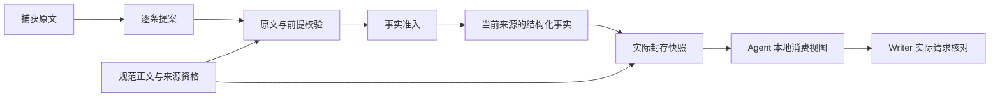

# Collector 逐题交付与同页 RAG 升级

日期：2026-10-19。对应用户授权的 Collector 通用功能、离线验证及四家真实流程复验。暂不训练模型。

**状态：通用功能与工程验证完成，真实报告仍为0/4可交付。** 四组首次运行共30次真实模型调用、85808 provider token；正文3正确/0错误/5遗漏，回答记录2正确/0错误/6遗漏。完整身份、逐题判定及哈希见[结构化结果](2026-10-19-collector-question-delivery-results.json)。

## 1. 实际执行功能

### 抓取结构

正文与标题来自同一内容根。已有 HTML 中的真实 `details/summary`、唯一有效 `aria-controls` 问答可恢复；只有标题、空面板、隐藏或禁用控件不产生答案。恢复后再次核对完整引文与正文偏移，避免后续插入破坏先前问答。

有已知结构缺口时，在现有预算内最多尝试一次浏览器升级。跨渲染只用稳定且唯一的标识消除缺口；无标识原生问答不凭问题文字或 DOM 路径推断恢复。原始网页资格与结构完整性分别记录，局部空 FAQ 不再拒绝整页的其他合格证据。

### 源结构补提取

`source_structured_rules` 从当前问题选窗中的完整计费表格行及实际恢复的问答提出候选，与模型提案一样经过原文、上下文、前提和准入校验。它不额外调用模型，也不计算采购价格或完整账单。表头、脚注、服务和适用条件不能为通过检查而删除。

模型与规则提案逐条记录原句、位置、哈希、焦点、实际字段或拒因；全拒、重复和超容量均保留诊断。模型没有提出某条事实，与校验拒绝、转换失败分别计数。

### 逐题交付重放

真实 Collector 在存储后，把瘦 `question_delivery_v1` 记录放入既有 trace。它保留实际提取批次和事实关联，避免在每个来源或模型提示中重复整页正文。

重放使用真实知识库正文、来源角色、范围、版本和哈希，以及当前请求、原验证器、实际来源字段及实际快照。问题与提取批次的关联从真实 producer、focus 和 admitted items 重建；记录中的自报 ID 或哈希不授予事实资格。

**canonical 的旧 normalized 注解不是当前事实权威。** 两轮 SQLite 实证证明，同正文可以复用旧文档，而当前 RawSource 的新增事实仍进入快照。合同对旧注解仅记诊断，不新增存储版本，也不将正常守恒误报成未入库。

各 Agent 只在真实消费凭据验证后记录 `view_selected`。Writer 另核对实际请求 JSON、完整引文/值/条件、文本引用展开和真实模型调用 span，区分准备、尝试、成功、失败及省略。其他 Agent 的视图记录不冒充模型实际发送记录。Collector 合同的 `semantic_status` 保持未核实；Writer、QA 和最终内容评测另外判断答案是否完整。

### 同页知识库来源升级

调查已复现三道阻挡：来源容量、同页重复、批次 first-wins。仅升级已验证的同产品、维度、URL 且无结构化事实的知识库占位来源；采用当前合格来源整份数据，不提高来源预算、不合入旧事实或日期。真实 RAG 命中、SQLite、RunJournal 恢复、双到达顺序、快照及视图均有回归。恢复复用前重验实际 canonical 的原有 TTL 和未来时间规则；凭据只保留必要引用及哈希，避免标题正常脱敏破坏合法替换。

## 2. 离线验证

- 抓取层：127 项相关测试，SPEC 与 QUALITY 分别复跑通过。
- 逐题合同：49 项新增用例、617 项相关测试，两审分别复跑通过。
- 已覆盖真实模拟 HTTP、原验证器、临时 SQLite、实际快照、六类 Agent 消费、Writer 请求及 RunJournal 恢复。
- 同页升级：49 项新增用例、310 项相关测试，两审分别复跑通过；根代理独立运行本轮147项新增用例全部通过。
- 最终后端 **5811通过／1跳过**；变更范围 Ruff E9/F、diff、OpenAPI字节对比及累计集成审查通过。全库另有4项既存F401，均位于未改动测试。前端未变，未重跑。
- 全量首轮5810通过/1失败：旧事件循环测试拦截已被替换的解析入口；仅适配测试至当前入口并保留响应顺序断言，独立审查16项通过、相关163项通过后重跑全量。
- 四家真实结果见下一节；上述工程数字不能替代语义准确率。

## 3. 真实复验协议

沿用已曝光的 Bitwarden、1Password、Dropbox、Cloudflare 八题，每组冻结版本各运行一次。运行输入只包含问题与官方来源身份，不含参考答案、审核节选或验收标签。每组最多 24 次调用、80000 token，输出上限 2048、模型重试 0。

分别核对 Collector 事实守恒、下游实际选择/发送和最终正文。测试运行结束、QA 无阻断、机械交付和报告可交付分别判断。新报告未获用户验收，`reward=null`、`training_ready=false`。

运行前后707份Python/参考文件、启动与统计helper哈希一致，旧268份产物及人审参考未改。生产包SHA：`9afef23c3ae0f92e2614d5f15371489b865eb100202e601066f863b2bc317fd4`。实际模型为 `deepseek-flash`，无未知usage span，不把token统计当账单。前后网络返回与模型选择不同，不构成受控A/B。

| 产品 | 实际调用 / token | 当前来源 / 快照事实 | 正文：正确 / 遗漏 | 记录：正确 / 遗漏 | 结果 |
| --- | --- | --- | --- | --- | --- |
| Bitwarden | 10 / 33152 | 3 / 75 | 1 / 1 | 1 / 1 | 局部稿，QA阻断1 |
| 1Password | 10 / 17621 | 1 / 3 | 1 / 1 | 0 / 2 | 局部稿，QA阻断1 |
| Dropbox | 0 / 无调用 | 0 / 0 | 0 / 2 | 0 / 2 | 无可准入来源，下游未执行 |
| Cloudflare | 10 / 35035 | 1 / 45 | 1 / 1 | 1 / 1 | 局部稿，QA阻断0仍不交付 |

正文与回答记录分别由只读代理对照用户已认可边界及本次原文核对，局部答案计遗漏；这不是用户对新报告的人审。八题均无已发表错误结论，但遗漏仍阻断完整交付；不能将错误减少称为整体改善，Dropbox本次连原文都未取得。

### 逐题与交付链结果

- **001 免费组织：正文与记录正确。** 两位用户、两个collections及“不能满足”进入正文，引用对应原始套餐页。
- **002 删除成员：正文与记录遗漏。** My vault/My Items/永久删除原始事实在快照中，但未进入Writer已选证据视图；上游分析仅有部分转述。完整SSO原句虽已发送，最终澄清仍未发布。
- **003 访客：正文正确，记录遗漏。** 单一保险库/无Private vault已发表；中间审核有正确否定，最终回答记录仍变成未核实，不能用中间模型输出冒充最终交付。
- **004 Unified Access报价：两项遗漏。** 五个FAQ的答案存在metadata，但问题文字为空，保持`empty_disclosure_question`，浏览器升级归档为`browser_fetch_error`；定制报价未进入正文/提案。通用缺项模板安全拒绝金额，却没给出联系销售的已知理由，还重复索要已给的一年周期。
- **005、006 Dropbox：两项均遗漏。** 两页仅得33字符导航壳，短正文拒绝后为`capture_not_successful`；未绕过准入、未调用下游模型、无报告。
- **007 域权限：正文与记录正确。** 保留特定域、给定范围和无其他角色条件，逐条引用成立。
- **008 Workers账单：两项遗漏。** 26644字符定价正文已捕获，但重复`Footnotes`标题导致章节定位歧义，实际抽取请求`body`为空，没有计费提案。最终模板没明确CPU用量及账户月最低范围，虽标已回答仍不通过。

四组都有合同记录；三组有实际Writer发送事件。对已选视图的8个事实观察记录完整，未记录该视图内省略；这不证明相关快照事实都已被选中。按保存ID独立对账，41个不同的accepted item ID均存在于当前normalized和快照，未发现该段转换ID丢失；仅是ID存在性，不是完整语义或未脱敏内容重放证明。语义recipe重放仍有unsupported extractor和脱敏限制，不能拿合同记录条数当召回率。重放失败中出现的`conversion_missing`不能单独证明数据库丢失，须与实际normalized/快照逐层对账。

九份页面捕获保留导出哈希，其中一份正文脱敏；1Password的Writer输入也有脱敏段，不能称完整明文重建。三组Analyst、Comparator、Reflector、Writer、QA均有真实调用；Dropbox在Collector阻断。新项目流程未触发同页RAG升级，该分支的本轮证据来自真实SQLite/RunJournal离线回归。

## 4. 验收边界

本轮不保证任意自然语言需求的全召回或语义完整，不把已曝光开发回归计作盲测。固定官方 URL 的阶段流程不代表 Planner 自动发现、完整 Graph、生产稠密索引或部署服务已验收。无训练、权重下载、Docker 或新基础设施执行。

默认 trace 脱敏可能改写 capsule 中的标题或引文，使其重放保守标记 `partial`。累计审查用真实存储、来源合并和封存链复现了这一限制，两条正文事实仍进入快照；它不是事实丢失，也不能据此将审计状态改成成功。后续应以可从规范原文重建的更精简记录改善审计可用率，继续保留脱敏。

## 5. 下一步

1. 先修抓取剩余缺口：基于真实页面结构恢复FAQ问题文字，并使浏览器失败与导航壳诊断更可操作；不把metadata里孤立的答案直接冒充完整问答。
2. 修问题选窗：重复章节标题使用具体章节身份和原文位置消歧；计费问题必须确认非空正文及完整同服务表格/脚注进入提取器。
3. 修快照到回答：按问题保留关键原始事实与前提，追踪最终回答记录丢失；具体缺项答复保留产品定价方式，避免索要题目已给条件。
4. 改善审计记录的可重建性，降低正常脱敏造成的partial；继续区分事实入库、视图选择、实际发送和语义验收。

以上完成后再扩大独立未曝光评测；当前不训练模型，不把这批开发回归生成自动奖励。
