# Competiscope v2 项目说明

> 更新日期：2026-11-02。整理基线：`a49ffae4`。本文按实际代码和已完成验收描述项目；默认值以配置源码为准，机器上的私有配置可能不同。

## 1. 项目定位与阅读方式

Competiscope 是一个产品调研与竞品分析工作台。用户给出目标产品、市场、研究问题和可选竞品，系统完成研究规划、资料采集、证据整理、分析比较、报告生成及审阅。调研对象覆盖软件、硬件和其他产品，不限定 AI 产品。

核心交付物是一份能追溯来源、说明适用条件、保留未知项的产品分析报告。平台同时保存任务、项目、资料、版本、调用和审核记录，供后续复用与排查。

| 阅读目标 | 建议顺序 |
| --- | --- |
| 理解产品与用户操作 | [系统总览](#overview) → [M1 工作台](#m1-workbench) → [M8 报告协作](#m8-collaboration) |
| 理解后端事务与高并发 | [M2 提交派发](#m2-submission) → [M6 执行治理](#m6-runtime) → [M7 数据存储](#m7-storage) |
| 理解 Agent 与 RAG | [M3 Agent 流水线](#m3-agents) → [M4 采集与 RAG](#m4-retrieval) → [M5 写作与 QA](#m5-quality) |
| 判断当前完成度 | [验收与边界](#acceptance) → [优先待办](#roadmap) |

本文配有七张静态 SVG 链路图，每张图下面保留可展开的 Mermaid 图源。图源与静态图需要同步更新；图表描述模块关系，不是实际运行截图。

文中的状态含义：**已实现**表示有实际代码入口；**本机已验**表示已在注明场景验证；**实验**表示需要显式开关；**待验**表示已有适配或方案，但相应运行环境／效果尚未完成验收。状态不能互相替代。

<a id="overview"></a>
## 2. 系统总览：八个大模块如何衔接


<details>
<summary>查看 Mermaid 图源：系统总览与八大模块</summary>

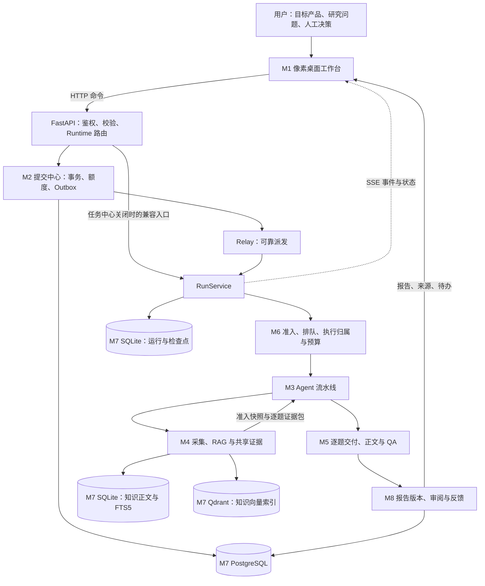

</details>

| 模块 | 主要子功能 | 交给下游的内容 |
| --- | --- | --- |
| M1 工作台 | 研究创建、窗口／任务栏、任务管理、知识库、证据、报告阅读 | 带工作区／项目范围的研究请求与人工操作 |
| M2 提交派发 | 幂等、次数预占、Outbox、取消、派发重试、提交查询 | 稳定业务身份的运行意图 |
| M3 Agent | 规划、采集、分析、比较、反思、写作、阶段 QA | 带来源与依赖的阶段产物 |
| M4 采集与 RAG | 搜索、抓取、清洗、分块、索引、混合召回、准入 | 可追溯资料与合格证据快照 |
| M5 写作与 QA | 按题选证、单关系生成、源审、条件推导、正文投影 | 同版本的正文、问答、审核及真实缺口 |
| M6 执行治理 | 背压、同机协调、模型并发、缓存、预算、中断恢复 | 有界执行、明确失败和可恢复状态 |
| M7 存储 | 企业业务数据、运行日志、知识正文、向量、产物文件 | 可查询、可重放的数据基础 |
| M8 报告协作与观测 | 人工介入、局部重做、改稿、版本、审批、导出、Trace | 可审阅的报告和下一轮研究输入 |

这是一套模块化应用与可选服务适配器。当前验收不代表所有模块都已拆为独立微服务，也不代表跨机器高可用部署已完成。

<a id="m1-workbench"></a>
## 3. M1：前端工作台与研究输入

### 3.1 用户能操作什么

前端使用 React、TypeScript、Vite、Zustand，采用明亮的田园像素桌面表现。窗口、任务栏和应用入口组织在网页中；关闭应用窗口是界面操作，后台任务通过服务端继续执行。

| 子功能 | 用户操作 | 后端衔接 |
| --- | --- | --- |
| 研究任务 | 填目标产品、官网、品类、市场、用户、场景、决策问题与指定竞品 | 创建研究请求，交 Runtime／提交中心 |
| 提交中心 | 查看提交、派发结果、取消及人工重试 | 提交单与次数账本接口 |
| 任务管理器 | 查看运行进度、历史与阶段详情 | Run 查询、SSE、Trace |
| 知识库／检索／采集队列 | 导入资料、查文档、检索、抓取和查看失败项 | knowledge、crawl、证据准入 |
| 证据文件／竞品档案 | 查来源、引用、产品资料与比较结果 | 企业证据及报告关联 |
| 报告阅读器 | 阅读、追溯引用、审阅、修改与下载 | 报告版本、人工决策、产物接口 |
| 活动中心／设置 | 查看通知、调整显示与语言、了解运行状态 | 活动记录与运行能力信息 |

### 3.2 研究配置是四个独立维度

| 维度 | 选项 | 影响 |
| --- | --- | --- |
| 竞争视角 | L1 直接竞品／L2 相邻替代／L3 市场视角 | 找哪些产品与替代方案 |
| 研究深度 | quick 极简／standard 适中／deep 详细 | 范围、竞品数、研究预算和报告长度 |
| 协作方式 | AI／assisted 半人工 | 是否在计划、证据、最终审核节点等待人工决策 |
| 执行方式 | demo／real | 合成演示流程，或实际配置的模型与资料服务 |

极简模式仍需来源与条件核对。详细模式仍受部署预算约束。半人工节点和全 AI 路径共享证据约束；real 模式所需的模型、搜索和存储服务要单独配置。

研究问题可覆盖目标用户、使用场景、共同能力、定价、替代关系和切换成本。当前默认核心维度是 `feature` 与 `pricing`，扩展范围由场景与研究计划决定；本轮八题回归不证明这些产品经理维度已全部验收。

**代码入口：**[应用入口](frontend/src/App.tsx)、[桌面应用映射](frontend/src/features/desktop/apps.tsx)、[研究创建](frontend/src/features/new-run)、[报告阅读](frontend/src/features/report)、[API 客户端](frontend/src/api)。

<a id="m2-submission"></a>
## 4. M2：运行入口、提交中心与可靠派发

### 4.1 一次提交如何进入执行

Runtime 负责用户权限、工作区范围、执行策略及后端路由。开启任务中心后，将执行意图先落到 PostgreSQL，再由 Relay 派发；兼容入口也接入相同的提交身份约束。

有两种入口：`POST /api/task-submissions` 接受持久提交并返回 202，后续由 Relay 执行；兼容的运行创建入口经 Runtime／RunService，在开启任务中心时也走提交桥接，并可能在桥接内尝试一次派发。下图对应前一种异步提交链路，两者共享幂等和额度约束。

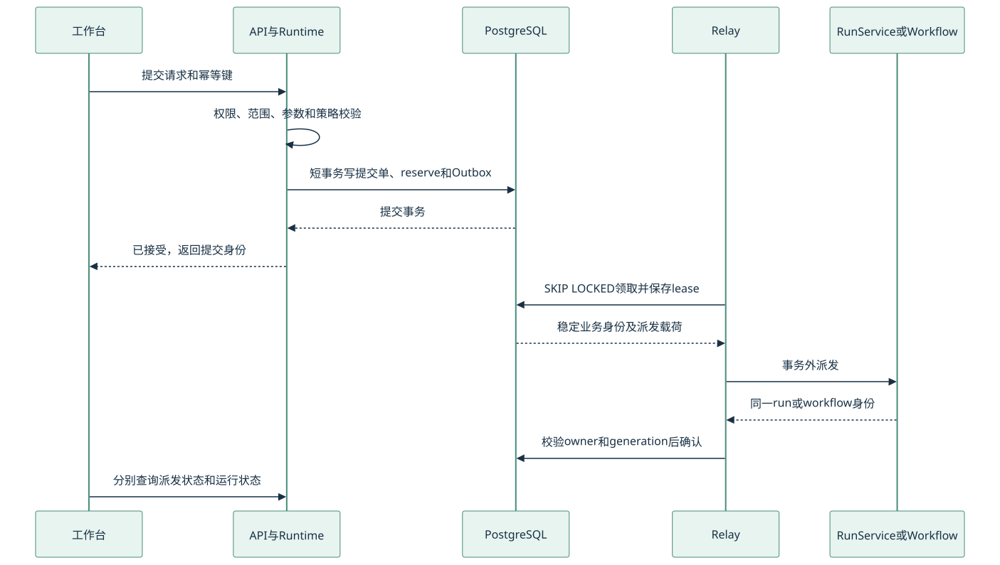

<details>
<summary>查看 Mermaid 图源：提交事务与可靠派发</summary>

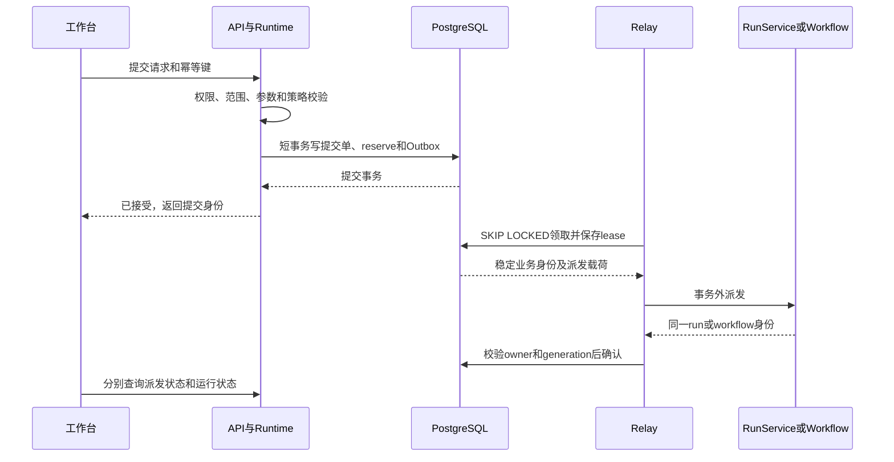

</details>

### 4.2 子功能与一致性约束

| 子功能 | 实际行为 | 约束 |
| --- | --- | --- |
| 幂等提交 | 同工作区同键同请求重放原业务身份 | 同键异内容返回冲突，不重复扣次数 |
| 额度账本 | 一次提交预占一次任务次数 | 次数、模型 token、模型费用分别记账 |
| 原子落库 | submission、reserve、Outbox 在同一事务写入 | 数据库接受后再执行网络派发 |
| 多 Relay 领取 | 短事务、行锁、lease、owner token、generation | 过期 owner 不能确认新一代状态 |
| 取消／人工重试 | 符合条件的 pending 取消释放原周期预占；重试沿用原单 | 已有发送意图或结果未知时保守保留预占 |
| 运行观测 | submission 与 run 分开查询、关联 | dispatched 表示派发确认，completed 也不证明报告合格 |

派发采用**至少一次投递与接收侧幂等**。外部调用结果未知时可能已经执行或付费，系统不承诺外部 exactly-once。

### 4.3 关键接口

| 接口 | 用途 |
| --- | --- |
| `POST /api/task-submissions` | 接受新提交或幂等重放 |
| `GET /api/task-submissions`、`GET /api/task-submissions/{id}` | 分页查询、观察提交及关联运行 |
| `POST /api/task-submissions/{id}/cancel` | 取消符合条件的提交 |
| `POST /api/task-submissions/{id}/retry-dispatch` | 人工重试失败派发 |
| `GET /api/workspaces/{id}/quota-ledger` | 查询任务次数账本 |

次数不足、执行准入拥塞和连接池／数据库不可用分别有明确结果。提交中心返回 202 表示持久意图已接受，不保证任务立即运行；执行拥塞可在后续派发时暴露。HTTP 提交入口不执行任务中心迁移 DDL，也不持有迁移 owner 凭据。

**代码入口：**[Runtime](backend/packages/runtime/service.py)、[提交接口](backend/app/routers/task_submissions.py)、[任务中心服务](backend/packages/task_center/service.py)、[仓储](backend/packages/task_center/repository.py)、[Relay](backend/packages/task_center/relay.py)。[事务及本机验收记录](docs/optimization/2026-10-29-task-center-delivery.md)。

<a id="m3-agents"></a>
## 5. M3：多 Agent 流水线

### 5.1 主链路与回退位置


<details>
<summary>查看 Mermaid 图源：多 Agent 流水线与重做路径</summary>

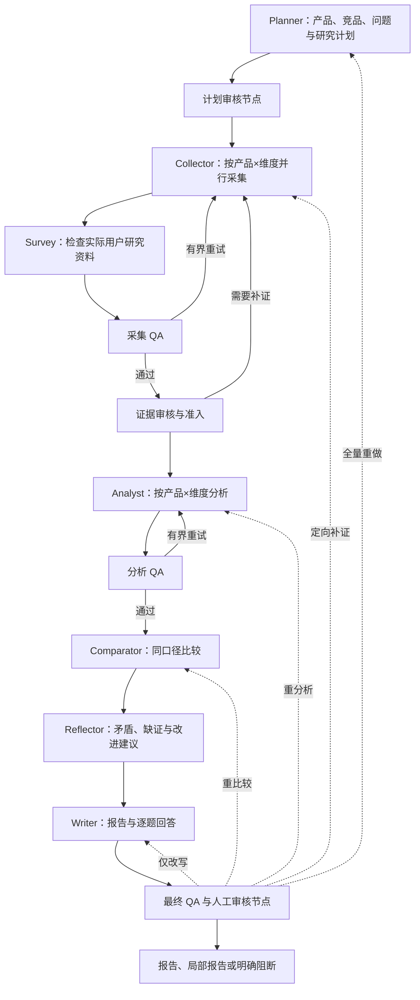

</details>

图中的人工审核节点是否等待用户，由协作配置决定。重试次数、阶段超时和预算仍生效；失败可能终止或产生明确回退，不保证每个阶段总能得到有效模型产物。

### 5.2 各 Agent 的交付合同

| Agent | 输入 | 要交付什么 | 与下一步的衔接 |
| --- | --- | --- | --- |
| Planner | 用户问题、产品信息、竞争视角、深度和预算 | 研究计划、竞品、维度、问题与任务拆分 | 给 Collector 明确搜集目标；题设条件不写成来源事实 |
| Collector | 产品×维度任务、逐题缺口、知识库候选和允许工具 | 捕获原文、来源身份、结构化事实、完整条件及采集缺口 | 经过准入形成快照，不把搜索摘要直接当作确定结论 |
| Survey | 实际用户研究资料 | 可用用户证据及缺失说明 | real 模式不编造访谈来填空 |
| Analyst | 当前准入快照、逐题证据包、实际发送窗口 | 结构化产品分析、条件、引用和未知项 | 记录依赖及回退状态，供比较与写作消费 |
| Comparator | 同范围证据、有效 Analyst 产物 | 同操作／对象／角色／套餐条件的比较矩阵、差异与缺口 | 不把不同前提的能力直接比较；缺证时保留未知 |
| Reflector | 分析、矩阵、消费记录和已有问题 | 矛盾、薄弱主张、真实缺证和重做建议 | 问题进入 Writer／最终 QA；未解决的历史项保留 |
| Writer | 合格证据、有效上游产物、原问题和写作要求 | 正文、逐题回答、主张引用绑定和交付缺口 | 最终投影与 QA 核对同一版本 |
| QA | 实际产物、完整问题、精确支持及历史问题 | 阶段判断、逐条审核、问题级结果和重做范围 | 审核完成与报告放行分别记录 |

各角色的 runner 是组织入口，部分实际逻辑通过 `RunService` 及 mixin 执行；不能只看 runner 文件长度判断 Agent 是否有实现。真实 DAG 以 [graph.py](backend/packages/orchestrator/graph.py) 为准。

### 5.3 共享证据如何对齐

1. 合格资料形成带版本及哈希的证据快照。
2. 每个 Agent 获得按问题、产品、维度和预算组织的视图，记录实际发送、遗漏及原因。
3. 下游消费 Analyst、Comparator 等产物时校验快照和上游依赖；失效产物不能继续冒充当前分析。
4. 来源更正、退休或重做后重新核对依赖；旧轮原件仍留作审计。

“共享快照”不表示每次调用都塞入全部资料；“资料已入库”也不表示某条事实已经发送给 Writer 或发表到正文。

**代码入口：**[Graph](backend/packages/orchestrator/graph.py)、[RunService](backend/packages/orchestrator/service.py)、[证据上下文](backend/packages/orchestrator/evidence_context.py)、[逐题包](backend/packages/orchestrator/question_packets.py)、[Agent 目录](backend/packages/agents)、[详细执行说明](docs/agent-execution.md)。

<a id="m4-retrieval"></a>
## 6. M4：外部采集、知识库与 RAG

### 6.1 采集侧有哪些子功能

| 子功能 | 处理内容 | 关键边界 |
| --- | --- | --- |
| 搜索与官方来源发现 | 搜索服务、官方来源、产品及问题定向查询 | 来源登记和相关性校验；来源地址本身不证明事实 |
| 网页 Fetch | HTTP、可选渲染、DeepSeek Search／Fetch 适配 | 登录壳、失败页、缺正文和抓取遗漏要单独记录 |
| 结构恢复 | FAQ、表格、套餐、正文窗口、相邻前提与例外 | 原文坐标及绑定保留；相邻出现不等于同一适用对象 |
| 语义提取与准入 | 有界提取、产品／服务绑定、角色／套餐／价格条件 | 候选仍需审核，用户要求不充当来源事实 |
| 缺口补证 | 按问题缺口寻找、提取和重交证据 | 只修目标缺口，保留成功项及失败原件 |

例如，1Password 报价 FAQ 的实际 HTML 中，问题文字可位于图标控制器旁。当前恢复逻辑要求唯一、可见且能证明关联的标题与答案；不能从按钮描述自造产品规则。

### 6.2 入库、召回与证据消费链


<details>
<summary>查看 Mermaid 图源：RAG 入库、召回与共享证据</summary>

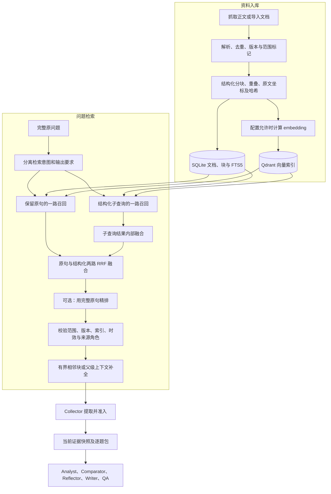

</details>

图中原句／子查询各路的 sparse、dense、hybrid 行为受配置控制。双路融合、向量召回与精排不是所有运行默认同时启用。

### 6.3 当前 RAG 的实现口径

| 子功能 | 当前实现 |
| --- | --- |
| 文档与分块 | 保存完整正文、版本、来源范围、块坐标与哈希；分块配置支持重叠，结合文档结构 |
| 稀疏召回 | SQLite FTS5／BM25，适合产品名、型号、术语、数字等 |
| 稠密召回 | Qdrant；索引身份绑定 embedding 模型版本、维度与索引版本 |
| 多语 embedding | 已接本机 `intfloat/multilingual-e5-small` 等 provider；实际启用需配置本机权重 |
| 精排 | 可选本机 `BAAI/bge-reranker-v2-m3`；失败／降级状态需要查看实际 provider |
| 融合与补全 | 原句＋结构化双路 RRF；排名锚块与额外上下文分别保留，补全收益不算排序收益 |
| 范围与时效 | 工作区、项目、产品、来源角色、日期及原文版本校验 |
| 评测 | 固定资料、人工审核状态、原文坐标、模型版本和代码哈希；支持离线对照与消融 |

源码默认检索模式为 `sparse`，示例 embedding／reranker 默认为 `hash`。hash 用于确定性开发测试，不具备真实多语语义能力。启用实际本机模型后，应通过 `GET /api/knowledge/providers` 核实 provider 和降级状态；严格验收使用 `KB_LOCAL_MODEL_STRICT=1`。

Collector 触发知识库预检索、资料入库与准入；后续 Agent 主要读取共同快照及各自证据视图，并非每个 Agent 都自由执行一套互不相关的 RAG。知识库与企业证据投影通过桥接衔接。

旧报告可以作为研究背景和来源线索；当前 Collector 的事实复用入口要求 `source` 角色，报告文本不会自动升级为一手事实。动态价格、套餐和权限仍需核对原始来源及日期。

**代码入口：**[采集桥接](backend/packages/agents/collectors/kb_bridge.py)、[抓取](backend/packages/tools/fetch_page.py)、[DeepSeek Fetch](backend/packages/tools/deepseek_fetch.py)、[语义提取](backend/packages/research/extraction/semantic.py)、[入库](backend/packages/knowledge/ingestion.py)、[检索](backend/packages/knowledge/retrieval.py)、[查询意图](backend/packages/knowledge/query_intent.py)、[上下文补全](backend/packages/knowledge/evidence_context.py)、[Qdrant](backend/packages/knowledge/vector_store.py)、[企业证据桥接](backend/packages/rag/knowledge_bridge.py)。

<a id="m5-quality"></a>
## 7. M5：Writer、结构化结论与 QA

### 7.1 默认与实验路径

默认 Writer 按维度组织报告。新版逐任务交付需同时开启 `WRITER_TASK_EXECUTION_ENABLED` 和 `WRITER_QUESTION_ATOMIC_ENABLED`；两者源码默认均关闭。下面的精细任务链路描述该实验入口。


<details>
<summary>查看 Mermaid 图源：逐题选证、结论、正文与 QA</summary>

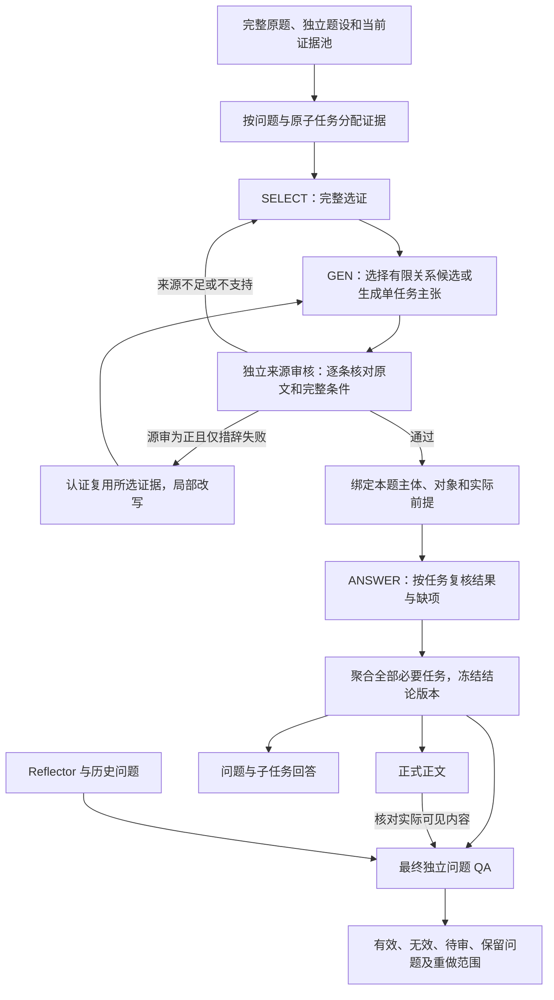

</details>

### 7.2 关键约束为什么存在

| 子功能 | 解决的问题 | 当前约束 |
| --- | --- | --- |
| 完整任务证据包 | 找到页面但漏选关键事实，或只选到不完整范围句 | 不借本任务未选原文补结论 |
| 有限关系候选 | 自由生成将多个操作、条件和数量混成一句 | 关系字段来自实际所选证据，模型选择后仍独立源审 |
| 题设与事实分离 | 将用户想要的角色、价格或人数写成官方事实 | 请求只作应用前提，不能证明产品规则 |
| 当前身份适用性 | 已升级／不再是 Guest，却套用旧 Guest 上限 | 原 Guest 规则可保持正确，但对不适用人物不能发表该 No |
| 并列任务交付 | 一个成功操作掩盖其他漏答 | 独立操作分别审；父题按必要子任务汇总 |
| 正文投影 | 已审核事实没有真正写入报告 | 正文、问答与 QA 使用同一冻结结论版本并校验实际内容 |
| 局部补交与预算 | 失败项反复全量重做、挤占最终回答和审核 | 有界补交、保留成功项，按真实任务包保护剩余预算 |
| 冷重建 | 只有 JSON 或哈希一致，却无法证明真实生成链 | 重建实际生产者、源审、任务选择和消费身份 |

有限关系覆盖数量上限、访问基数、角色／资源范围、独立操作、许可与义务区别、报价性质、计费缺项等。复杂语言不能被证明时保持未知；这不是通用自然语言逻辑证明器。

### 7.3 QA 同时要看三件事

以下为判断视角，不是新增 API 状态枚举：

| 判断视角 | 示例 | 含义 |
| --- | --- | --- |
| 事实是否已知 | 缺 CPU 用量，无法算完整账单 | 金额仍未知 |
| 当前答复是否完成 | 已说明 CPU 独立计费，并指出所缺用量 | 缺项答复可以完整交付 |
| 整份报告能否放行 | 还有历史 blocker 或计划项未送审 | 系统门禁可能仍不通过 |

新鲜独立问题 QA 使用 `independent_questions_v11`：先认证整份可见观察，再按题投影实际发表内容；当前问题和历史 finding 使用不同审核范围。旧协议、原请求和缓存身份按各自合同保留。

QA 不依赖 Reflector 成功才启动。坏 JSON、缺必需字段、超窗、超时、未送审和真实保留意见分别记录；格式无效不会被算成有效的同意或反对。

### 7.4 当前仍有两处系统闭环未完成

| 产品 | 正文／当前问题 | 系统遗留 | 后续处理 |
| --- | --- | --- | --- |
| Trello | 固定原题全部必要分支已回答 | 一项历史收费 finding 在本轮窗口未送审 | 完成待审项继续调度，实际审核后再汇总 |
| Bitwarden | 必要的操作与数据归属澄清已完成 | 历史“留存事实未核实”blocker 保留 | 补证，或明确局部报告释放政策；不能把历史缺证直接删掉 |

**代码入口：**[完整任务包](backend/packages/agents/writer/task_evidence_package.py)、[任务选证](backend/packages/agents/writer/selected_task_delivery.py)、[结构化结论](backend/packages/agents/writer/structured_conclusions.py)、[权限关系](backend/packages/agents/writer/permission_relations.py)、[最终任务回答](backend/packages/agents/writer/task_answer_outcomes.py)、[统一发表](backend/packages/agents/writer/conclusion_publication.py)、[补交预算](backend/packages/agents/writer/task_repair_budget.py)、[最终 QA](backend/packages/agents/qa/independent_question_review.py)。

<a id="m6-runtime"></a>
## 8. M6：并发、缓存、预算和恢复

### 8.1 不同层的限制分别控制什么


<details>
<summary>查看 Mermaid 图源：分层并发控制与预算</summary>

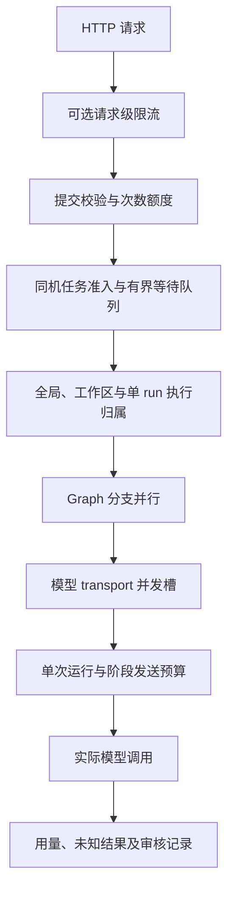

</details>

并发槽限制同时在途数量；次数额度限制研究提交；token／费用预算限制模型消耗。三者分别生效，单一并发配置不能代替完整的容量与限流治理。

### 8.2 具体子功能

| 子功能 | 当前实现 | 边界 |
| --- | --- | --- |
| 准入与背压 | 有界 ticket、全局／工作区队列、满载 429 与 `Retry-After` | 验收为同机共享 journal／锁目录 |
| 执行归属 | SQLite、POSIX 文件锁、token／generation、revision CAS | 不提供已验收的跨主机分布式锁 |
| 模型并发 | 普通生成、查询改写、原生模型搜索等在 transport 前申请 slot | 独立 Search／Fetch API 与生成池分开；并发上限不等于供应商 RPM／TPM |
| 页面缓存 | 合格公共页面可复用，保留原采集时间 | 价格、敏感 URL、强制刷新及独立 DeepSeek Fetch 绕过公共页复用 |
| 冷并发去重 | 公共页和相同 query embedding 使用 single-flight | 本进程去重；结果仍需按工作区／项目重验 |
| 可选 Redis | 公共缓存、请求限流、owner token 条件发布／释放 | 适配已接；真实 Redis Lua／TTL／断连仍待部署机验收 |
| 阶段预算 | 调用／token／估价限制、Writer／QA 预留、失败项差量预留 | 已发送但结果未知的消耗保守记录；不重置旧检查点额度 |
| 中断恢复 | 持久 journal、图检查点、显式恢复、SSE 游标补读 | 恢复任务执行不代表报告内容自动合格 |

本机控制源码默认关闭。默认容量配置为全局运行 2、每工作区运行 1、等待队列 32／8；这些是配置起点，实际值与模型并发需按部署和实测调整。

**代码入口：**[执行协调](backend/packages/infrastructure/execution_control.py)、[协调工厂](backend/packages/infrastructure/execution_factory.py)、[single-flight](backend/packages/infrastructure/singleflight.py)、[公共缓存](backend/packages/infrastructure/source_cache.py)、[模型预算](backend/packages/llm/execution_budget.py)、[图检查点](backend/packages/orchestrator/checkpointer.py)、[RunJournal](backend/packages/memory/run_journal.py)。[本机并发验收](docs/optimization/2026-10-28-local-concurrency-delivery.md)。

<a id="m7-storage"></a>
## 9. M7：数据库、文件与数据身份

### 9.1 数据具体存到哪里

| 存储 | 保存内容 | 谁读写 | 当前边界 |
| --- | --- | --- | --- |
| PostgreSQL | 持久工作区的项目、报告与企业业务数据；提交单、任务次数账本、Outbox | 企业 Store、任务中心、Relay、Runtime | 原生 15.18＋pgvector 0.8.7 本机验过；不是所有数据都已迁入 PG |
| SQLite：运行侧 | run journal、事件、执行归属、检查点、Trace／偏好等配置对应数据 | RunService、协调器、恢复与事件流 | 同机多进程须共享实际路径与锁目录 |
| SQLite：知识侧 | 文档、版本、正文块、元数据、FTS5 与同步记录 | KnowledgeRepository、入库及检索服务 | 正文与元数据是可回查依据 |
| Qdrant | 知识块向量及范围过滤载荷 | 向量索引、稠密召回 | 本机持久化模式验过；多进程部署需 HTTP 服务并另行验收 |
| 产物文件 | 报告、导出及本机工作区产物 | Artifact／报告接口、工作台 | 跟随工作区备份，不能只备数据库 |
| Redis（可选） | 缓存与限流运行数据 | 缓存／限流适配器 | 业务与原始来源仍由持久存储负责 |

PostgreSQL 的 SQL 引擎就是 PostgreSQL；pgvector 是其向量扩展。Qdrant 是知识检索所用的另一种向量存储。企业侧证据投影与知识库正文／索引有明确桥接，分别维护自身身份和版本。

### 9.2 一条结论的追溯链

```text
workspace_id / project_id
  → submission_id / 幂等键 / expected_run_id
  → run_id / 当前快照 / question_id / task_id
  → source_id / document 或 fact 版本
  → 原文 span、坐标、内容哈希
  → 实际 SELECT / GEN / REVIEW / ANSWER 调用与结果
  → 冻结结论 revision
  → 正文 / 问答 / QA receipt / 报告版本
```

这些身份承担不同职责：URL 不等于证据已准入，哈希不等于来源审核通过，报告版本也不等于已发布。查询链路时要同时检查身份、实际内容和审核记录。

**代码入口：**[企业存储](backend/packages/enterprise)、[任务中心数据库](backend/packages/task_center/database.py)、[知识仓储](backend/packages/knowledge/repository.py)、[证据快照](backend/packages/research/evidence/snapshot.py)、[证据消费](backend/packages/orchestrator/evidence_context.py)、[产物模块](backend/packages/artifacts)。

<a id="m8-collaboration"></a>
## 10. M8：报告协作、可观测与模型接入

### 10.1 从报告回到下一轮研究


<details>
<summary>查看 Mermaid 图源：报告审阅、版本与研究反馈</summary>

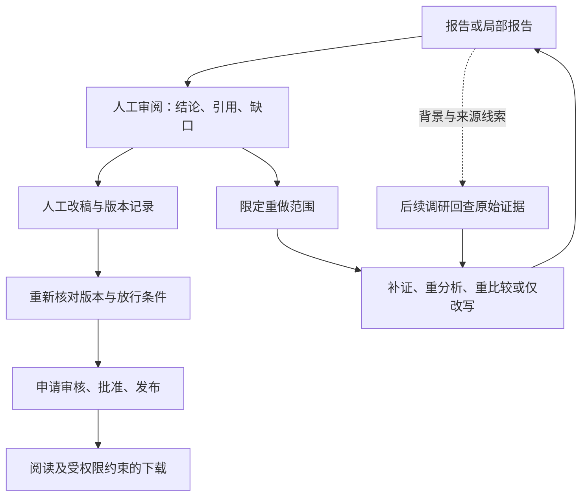

</details>

批准／发布接口有各自生命周期与权限校验，自动任务结束不自动等价于批准发布。下载行为也不证明内容已通过全部审核。

| 子功能 | 实际用途 | 对齐要求 |
| --- | --- | --- |
| 人工介入 | 计划、证据、最终审核；接受、拒绝、补充与重做 | 决策绑定实际任务及有效快照 |
| 定向重做 | writer_only／comparator／analyst／collector／full | 保留成功依赖；变更来源后重验受影响下游 |
| 人工改稿／版本差异 | 保存修订与比较 | 已批准／发布版本不能被普通写入绕过生命周期覆盖 |
| 报告导出 | Markdown、版本与范围对应的导出 | 权限、导出内容及脱敏边界独立核对 |
| SSE／Trace | 查看阶段、模型／工具调用、事件、回退、消费依赖和用量 | 失败、未知用量、未发送、未审核分别呈现 |
| Eval | 检索评测、Agent 隔离、真实模型固定页回放及工程故障验收 | 各指标有自己的样本、资料、环境及分母 |

### 10.2 模型、Prompt 和工具如何接入

模型客户端、搜索服务和抓取工具分别配置。现有接入包括兼容模型调用及 DeepSeek Search／Fetch 适配；启用原生搜索／Fetch 有独立开关，不应根据生成模型名称猜测某项联网能力已经启用。

Prompt 有阶段职责、输入上下文、输出 Schema、证据约束及工具边界；Trace 记录 prompt ID、版本、模板哈希和实际输入哈希。Writer 的内部任务合同还约束所选引用、返回结构、候选字段、审核身份及重放，不只依靠一段通用提示词。

工作区／项目范围、API 授权、受限数据库角色及运行策略分别生效。真实模型凭据放在本机私有配置／环境中，文档只列配置项名；前端不持有模型密钥。默认演示配置不作为公开服务部署配置。

**代码入口：**[人工决策](backend/app/routers/hitl.py)、[报告与企业接口](backend/app/routers/enterprise.py)、[事件流](backend/app/routers/stream.py)、[Trace](backend/app/routers/trace.py)、[Prompt 身份](backend/packages/agents/prompt_contract.py)、[模型客户端](backend/packages/llm/doubao_client.py)、[搜索](backend/packages/tools/web_search.py)、[配置默认值](backend/packages/config/settings.py)。客户端历史类名不决定实际 provider，实际配置与运行记录共同确定使用的模型。

<a id="acceptance"></a>
## 11. 当前验收：已证明什么，还缺什么

### 11.1 最新已提交记录

以下为已有验收结果，本次文档整理没有重新调用模型、执行全套测试或启动外部服务。

| 验收项 | 已有结果 | 解释边界 |
| --- | --- | --- |
| 后端完整回归 | 9766 通过、1 跳过、250 条既有弃用警告 | 工程测试通过不等于完整报告准确率 |
| 四家固定页面真实模型 | 原 8/8 题、22/22 必要分支完整；28/28 可见语义主张有精确支持 | 题目均已曝光，页面有明确捕获日期；不是盲测或全在线发现 |
| 当前问题 QA | 4/4 报告通过 | 当前答复完成；相关事实可继续未知 |
| 严格系统 QA | 2/4：Cloudflare、1Password 通过 | Trello 历史 1 项未送；Bitwarden 历史缺证 blocker 保留 |
| 原子性 | 独立事实 26/26；严格文本 26/28 | 两处为已审子结果的受控父题汇总，支持充分但不是单个原子文本单元 |
| PostgreSQL 提交链 | 原生 PG、事务／幂等／取消／重试／故障及实际 Graph demo 验过 | 2 API＋2 Relay 的 10／50／100 突发观测只衡量注明环境的提交接口 |
| 本机持久化工作台 | 浏览器创建任务、读取报告、正常停启后重载；10-30 前端 340 项及构建通过 | 该轮为 demo；11-02 未重跑前端测试，260 前端文件字节未变 |
| 语义 RAG | 本机开源 provider、固定资料检索与对照工具已有实现及离线验证 | 当前四家报告回放不证明生产语义 RAG 全链路合格 |
| 部署基础设施 | 有 Redis、Qdrant HTTP、Temporal 等适配与部署说明 | 真实服务、容器、跨主机容量及恢复仍需部署环境验收 |

四家最终轮真实模型传输 120 次，已知 token 412743，未知用量 0；服务端权重 revision 和实际供应商账单未独立确认。详情见[最终交付](docs/optimization/2026-11-02-delivery-semantics.md)、[脱敏统计](docs/optimization/2026-11-02-delivery-final-results.json)与其中四份原样报告。

### 11.2 开关与演示入口

| 配置／方式 | 源码或示例默认 | 使用注意 |
| --- | --- | --- |
| `TASK_CENTER_ENABLED` | false | 开启前按部署说明准备 PG、受限角色和迁移；本机持久化启动器会单独启用 |
| `EXECUTION_CONTROL_ENABLED` | false | 同机 API／Worker 共用 journal、锁目录与池配置 |
| `WRITER_TASK_EXECUTION_ENABLED` | false | 新逐题任务交付为实验路径 |
| `WRITER_QUESTION_ATOMIC_ENABLED` | false | 与上一开关共同控制本轮精细交付链 |
| `KB_RETRIEVAL_MODE` | sparse | hybrid／dense 需要实际模型、索引和对应配置 |
| `KB_QDRANT_LOCAL_PATH` | 未设置 | 设置后使用本机持久化目录；未设置时按 `QDRANT_URL` 连接服务 |
| `KB_EMBEDDING_PROVIDER`／`KB_RERANKER_PROVIDER` | 示例为 hash | 查看 provider 状态；不可将 hash 降级当作语义模型成功 |
| `REDIS_CACHE_ENABLED`／`REDIS_RATE_LIMIT_ENABLED` | false | 开启前验收真实 Redis |
| `DEEPSEEK_WEB_API_ENABLED` | false | 搜索 provider、原生能力与凭据分别配置 |

本机持久化入口是 `scripts/workbench_runtime.py`，默认四个 action 均只预览，需要 `--execute` 才产生相应执行行为。两组演示入口对应不同配置：

| 演示方式 | 前端 | API | 数据配置 |
| --- | --- | --- | --- |
| 轻量无 PG demo | `http://127.0.0.1:5173` | `http://127.0.0.1:8000` | 内存企业存储及对应运行配置 |
| 本机持久化 demo | `http://127.0.0.1:5180` | `http://127.0.0.1:8010` | 独立 PostgreSQL 工作区、SQLite 与产物 |

不要把两组端口下不同 profile 的任务当作同一份数据。两者均为 demo；real 需要另外配置实际模型、资料服务和部署策略。

```bash
# 仓库根目录，使用已安装项目依赖的 Python；以下均为零执行预览
WORKBENCH_PYTHON=.venv/bin/python
# 本次隔离 worktree 复用依赖时，改为 WORKBENCH_PYTHON=../plan_a/.venv/bin/python
"$WORKBENCH_PYTHON" scripts/workbench_runtime.py init
"$WORKBENCH_PYTHON" scripts/workbench_runtime.py start
"$WORKBENCH_PYTHON" scripts/workbench_runtime.py status
```

实际初始化、启动、停止、备份和迁移步骤见 [README](README.md) 与[部署说明](docs/docker_deployment.md)。该本机 profile 绑定 loopback／私有 PG socket，不作为直接对外开放的内网部署；跨路径／跨机恢复和容器接线另行验收。

<a id="roadmap"></a>
## 12. 下一阶段优先级

| 优先级 | 工作 | 应证明的结果 |
| --- | --- | --- |
| P0 | 历史待审继续调度、事实／交付／报告放行分级 | 无计划项静默遗留；保留真实缺证，同时明确局部报告的交付资格 |
| P1 | 独立未曝光样本、真实联网与多产品全流程 | 新产品仍能发现、抓取、入库、比较和逐题交付，不只通过已知回归 |
| P1 | 生产语义 RAG 整链验证 | 实际 provider、模型版本、召回与精排、来源准入及各 Agent 消费一致 |
| P2 | 部署机服务与真实负载验收 | Redis、Qdrant HTTP、Temporal、容器持久化、断连恢复和容量有实测边界 |
| P2 | 报告可读性与状态解释 | 减少规则重复，解释未知、已答、待审及受控汇总，不靠单一 pass/fail 标签 |

当前没有训练 Agentic RL／embedding／精排模型，也没有加入 Kafka；本机开发与验证未执行 Docker。训练、蒸馏与更复杂组件需要独立目标和评测依据，不作为已完成能力列入。

## 13. 代码与文档导航

```text
frontend/src/
  features/desktop/        像素桌面、窗口与应用入口
  features/new-run/        研究请求与模式配置
  features/report/         报告、来源追溯与阅读
  api/                     HTTP、SSE 与类型
backend/app/
  routers/                 运行、提交、企业、人工决策、Trace 等接口
  routes/                  knowledge 与 crawl 接口
backend/packages/
  runtime/                 用户命令与执行路由
  task_center/             PG 提交、次数账本、Outbox 与 Relay
  orchestrator/            Graph、RunService、快照与依赖消费
  agents/                  各 Agent、Writer 子任务、QA 合同
  research/                捕获、提取、证据准入与问题缺口
  knowledge/               正文、分块、索引、混合召回与本机模型
  rag/                     企业证据检索及知识桥接等适配
  infrastructure/          同机协调、缓存、去重与 Redis 适配
  llm/                     模型调用、预算与错误处理
  enterprise/              工作区、项目、报告、权限与业务存储
  memory/                  运行日志、Trace、偏好等持久化
scripts/workbench_runtime.py  本机持久化工作台控制入口
backend/scripts/           迁移、Relay、工程与语义验收工具
docs/optimization/         各轮计划、实际结果、失败与公开报告
```

| 文档 | 负责解释什么 |
| --- | --- |
| [README](README.md) | 安装、启动、配置与最新交付入口 |
| [Agent 执行说明](docs/agent-execution.md) | 各角色实际入口、合同、消费约束及历史演进 |
| [部署说明](docs/docker_deployment.md) | 同机协调、PG、权限、迁移、备份、容器及未验边界 |
| [API 合同](docs/api_contract.md) | 接口约定；实际路由与生成 OpenAPI 共同核对 |
| [最新交付与报告](docs/optimization/2026-11-02-delivery-semantics.md) | 当前正文、引用、QA 和工程验收结果 |
| [PG 提交中心交付](docs/optimization/2026-10-29-task-center-delivery.md) | 事务、幂等、账本、Relay 与真实数据库验收 |
| [并发治理交付](docs/optimization/2026-10-28-local-concurrency-delivery.md) | 背压、同机执行、缓存与故障场景 |
| [持久化工作台交付](docs/optimization/2026-10-30-persistent-workbench-delivery.md) | 本机数据、进程、浏览器操作及正常停启验证 |

历史架构资料可能同时包含目标设计和当时实现状态。判断当前能力时，优先核对本总览标注的版本、实际源码及对应验收记录。
